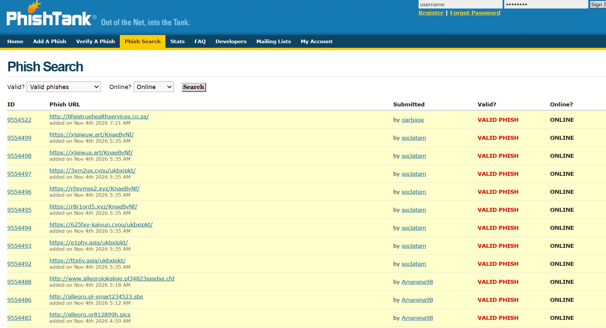
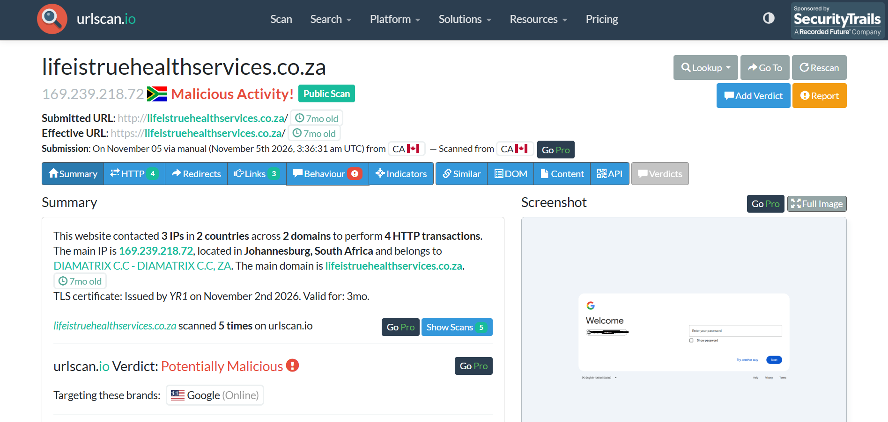
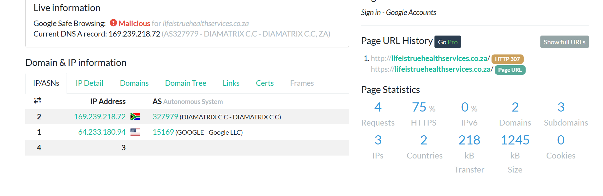
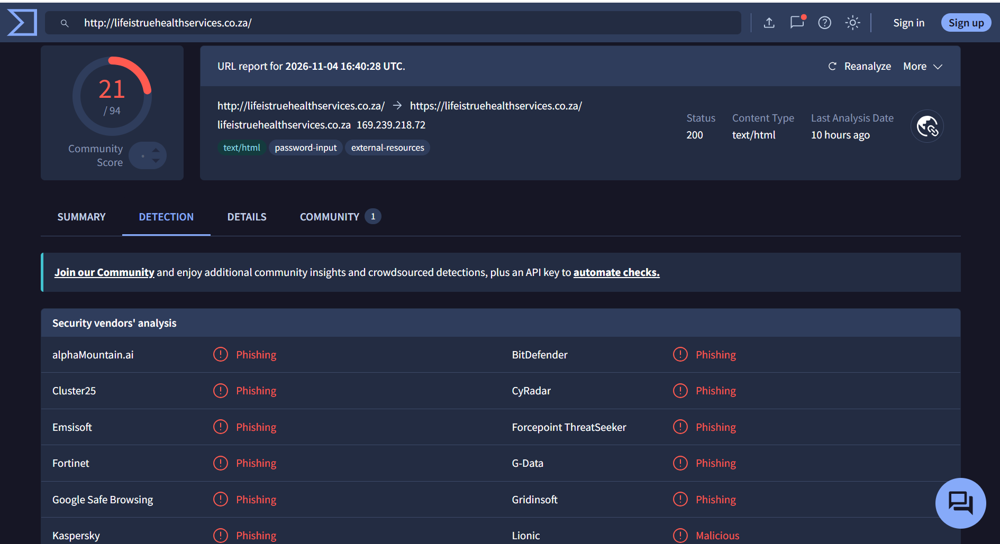
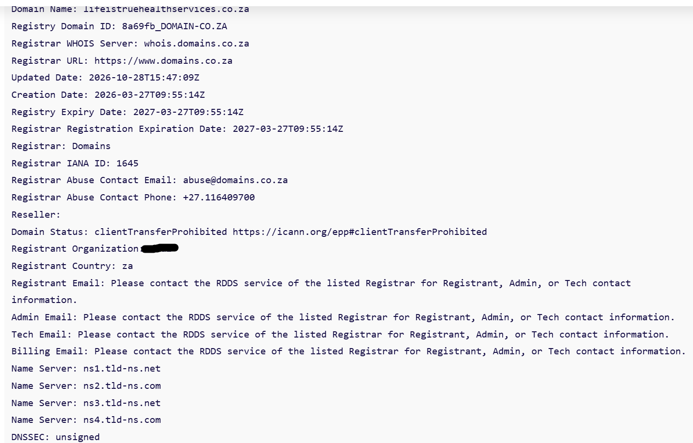

# Evidence log: lifeistruehealthservices[.]co[.]za

Investigation of one URL reported to PhishTank. I did not open the URL in a browser. Each finding is what a third-party page showed when I looked at it.

This is a training exercise. It is not a report from a live engagement.

## How to read the times

Each source time is copied as that page displayed it. I have not converted anything to Vancouver or Australian local time. I was in Vancouver, and the browser time zone may not match that. Screenshot filenames are local-clock labels only. They are not evidence timestamps.

The suspicious domain is written with the dot broken (`[.]`) so it is not a link.

## Screenshots used

| ID | File | What it is |
|---|---|---|
| E01 | `01-phishtank-verification.png` | PhishTank record 9554522: verified phish, online, network. |
| E02 | `02-urlscan-summary.png` | urlscan summary and captured page. Main page evidence. |
| E03 | `03-urlscan-redirect-details.png` | Page title, HTTP 307, DNS address, Safe Browsing line. |
| E04 | `04-virustotal-detections.png` | VirusTotal report time, 21/94, visible vendor labels. |
| E05 | `05-whois-registration.png` | Creation, update and expiry dates, registrar, status. |

Not included: the PhishTank search-results screenshot. It repeats E01 and lists unrelated URLs. I kept it privately. It is not part of this write-up.

The account identifier in the login form on E02, and the registrant organisation value on E05, are covered in the copies in this repo. The originals stay private.

## Indicator

- Reported URL: `http://lifeistruehealthservices[.]co[.]za/`
- Domain: `lifeistruehealthservices[.]co[.]za`

## E01 — PhishTank

Caption: PhishTank submission 9554522 was displayed as a verified phish and online. The page clock reads 5 November 2026, 3:32 AM UTC. The 100% bar is the vote split on that page, not a scanner score.

- Record: submission 9554522
- Page clock when viewed: 5 November 2026, 3:32 AM UTC
- Submitted: 4 November 2026, 7:21 AM, by the account "garbage". That clock does not say UTC.
- Status shown: currently online
- Verification shown: "Is a phish", by Dev, Shazza, darkmoon and June. No votes against were shown.
- Network shown: 169.239.218.0/24, AS327979, DIAMATRIX C.C, South Africa
- PhishTank had no WHOIS result for this extension, and no screenshot of the site
- I did not use "View site in frame" or "View site in new window". Both load the live site.

This is community verification. I am not treating the vote bar as a confidence rating.

## E02 — urlscan summary and captured page

Caption: The urlscan result dated 5 November 2026, 03:36:31 UTC shows a Google-branded password prompt on `lifeistruehealthservices[.]co[.]za`. urlscan marks it potentially malicious and names Google as the targeted brand. The brand and the domain do not match. That mismatch is the main thing I observed.

- Scan time shown: 5 November 2026, 03:36:31 UTC
- Submitted manually. The result says scanned from CA. That is urlscan's system, not my browser opening the site.
- Submitted URL: `http://lifeistruehealthservices[.]co[.]za/`
- Effective URL: `https://lifeistruehealthservices[.]co[.]za/`
- Verdict shown: Potentially Malicious, targeting Google (Online)
- Main IP shown: 169.239.218.72, Johannesburg, South Africa, AS327979, DIAMATRIX C.C
- Captured page: Google branding and a password field. The address stayed on this domain.
- TLS line shown: issued by YR1 on 2 November 2026, valid for 3 months. Recorded as shown. I have not checked the issuer beyond that label.
- A "7mo old" label appeared on the result. The WHOIS creation date is the source for age. The label is consistent with that date. I am not using the label on its own.
- The captured login form showed an account identifier. It is covered in the screenshot. It is not written here.

## E03 — urlscan redirect and supporting details

Caption: Page history shows an HTTP 307 from the HTTP URL to HTTPS on the same domain. The displayed title is "Sign in - Google Accounts". The same results page reports Google Safe Browsing as malicious. HTTPS only means the connection to that host was encrypted.

- Page title shown: Sign in - Google Accounts
- Page URL history: `http://lifeistruehealthservices[.]co[.]za/` then HTTP 307 to `https://lifeistruehealthservices[.]co[.]za/`
- Google Safe Browsing, as reported on this page: Malicious
- DNS A record shown: 169.239.218.72 (AS327979, DIAMATRIX C.C, ZA)
- Other IP contacted, as listed: 64.233.180.94 (AS15169, Google LLC). I am not treating that contact as proof of where a password would be sent.
- Counts shown: 4 HTTP requests, 3 IPs, 2 countries, 2 domains. No cookies were shown.

## E04 — VirusTotal

Caption: The VirusTotal report dated 4 November 2026, 16:40:28 UTC shows 21 of 94 vendors flagging the URL. Visible labels are phishing or malicious. The IP matches urlscan. The 21 of 94 figure is a vendor count, not a probability.

- Existing report. I did not run a new scan. Report time: 4 November 2026, 16:40:28 UTC
- Detection count shown: 21 of 94
- A vendor that did not flag it has not confirmed the URL is safe
- Vendors visible in this screenshot, labelled Phishing: alphaMountain.ai, BitDefender, Cluster25, CyRadar, Emsisoft, Forcepoint ThreatSeeker, Fortinet, G-Data, Google Safe Browsing, Gridinsoft, Kaspersky
- Lionic, also visible, labelled it Malicious
- The screenshot does not show all 21. I am not guessing the rest.
- Reported redirect: HTTP URL to HTTPS on the same domain
- IP shown: 169.239.218.72
- HTTP status shown: 200. Content type shown: text/html
- Tags shown: text/html, password-input, external-resources
- Google Safe Browsing appears here and on the urlscan page, so these sources are not fully separate confirmations

## E05 — WHOIS

Caption: WHOIS, looked up on 4 November 2026, shows the domain created on 27 March 2026 and updated on 28 October 2026. The screenshot has no lookup time of its own. Age and settings are context. They do not show who runs the site, or that it was compromised.

- Lookup date: 4 November 2026, from my own record. The screenshot is not timestamped.
- Source: registry lookup for `.co.za`, not PhishTank
- Domain: lifeistruehealthservices[.]co[.]za
- Registry domain ID: 8a69fb_DOMAIN-CO.ZA
- Created: 2026-03-27 09:55:14 UTC
- Updated: 2026-10-28 15:47:09 UTC
- Registry expiry: 2027-03-27 09:55:14 UTC
- Registrar: Domains (domains[.]co[.]za), IANA ID 1645
- Registrar abuse email shown: abuse@domains[.]co[.]za
- Registrant country: ZA
- Status: clientTransferProhibited
- Name servers: ns1.tld-ns.net, ns2.tld-ns.com, ns3.tld-ns.net, ns4.tld-ns.com
- DNSSEC: unsigned
- Registrant, admin, tech and billing email were not shown. The record says to use the registrar's RDDS service.
- Registrant organisation was shown. It is covered on the screenshot and left out here. It is not needed for the finding.

The domain was a bit over seven months old at the lookup. That, the transfer lock, and unsigned DNSSEC do not show whether the domain is malicious.

## What these five shots do not show

- Whether anyone submitted a password
- Where a submitted password would be sent
- Whether the site was compromised or put up for this
- Any email that carried the URL. None was available. I did not write one.
